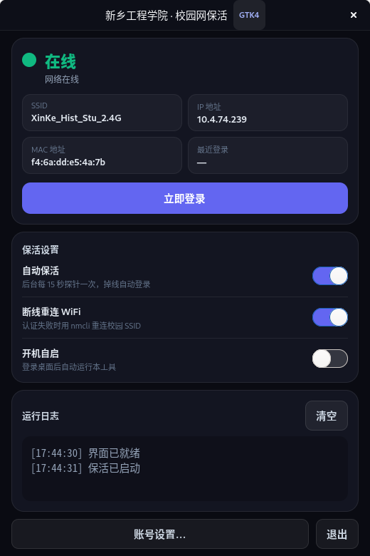

# linux-ui —— 校园网保活·轻量 GTK4 界面

给 Linux 桌面准备的**零依赖轻量界面**：不用编译 Tauri、不用装 WebKit，只依赖系统自带的
Python 3 + PyGObject（GTK4）。认证/探针/保活语义与仓库主程序（`src-tauri/src/lib.rs`）及
`xywdl.sh` 完全对齐。

> Windows 用户请继续使用 Tauri 桌面端；本目录面向 Linux（以及任何装了 PyGObject 的桌面环境）。



## 与主程序的关系

| | Tauri 桌面端 | linux-ui |
|---|---|---|
| 认证 | Rust 进程内原生直发 | Python 标准库 `http.client` |
| 保活 | Rust 状态机 | 同语义 Python 线程状态机 |
| 依赖 | WebKit2GTK + Rust 构建 | Python 3 + PyGObject（GNOME 自带） |
| 安装 | .deb / .rpm / tar.gz | 复制文件 + 桌面项 |
| 配置 | `~/.config/xxgcxy-wifi/` | **同一个目录、同一套文件** |

两者可以共存：配置互通，但请不要同时开两个实例跑保活。

## 功能

- 状态卡片：在线 / 待登录 / 检测中 / 登录中 / 离线 / 退避倒计时，以及 SSID、IP、MAC、最近登录时间
- 一键「立即登录」
- 「自动保活」：默认 15s 周期探针，掉线自动认证；成功后 3s 复验
- 「断线自动重连 WiFi」：`nmcli` 重连配置 SSID，60s 防风暴
- 「开机自启」：写入 `~/.config/autostart/xxgcxy-ui.desktop`
- 账号设置：学号 / 密码 / 运营商 / Portal URL（粘贴整条带参数的认证页链接会自动提纯）
- 滚动日志：分级上色，落盘到 `~/.config/xxgcxy-wifi/logs/`

## 安装

```bash
cd linux-ui
./install.sh             # 复制到 ~/.local/share/xxgcxy-wifi-ui 并创建应用菜单/桌面图标
./install.sh --uninstall # 卸载（保留 ~/.config/xxgcxy-wifi 配置）
```

也可以不安装直接跑：

```bash
python3 xxgcxy_ui.py
```

依赖检查：`python3 -c "import gi; gi.require_version('Gtk','4.0')"` 不报错即可。
Debian/Ubuntu 上是 `python3-gi` 包；GNOME 桌面默认已装。

## 命令行

```bash
python3 portal_core.py status   # 打印探针/网络/配置状态（JSON）
python3 portal_core.py login    # 执行一次认证
python3 portal_core.py watch    # 前台保活（适合 systemd / 无 GUI 环境）
```

## 协议对齐要点

| 环节 | 行为 |
|---|---|
| 探针 | 双 `generate_204` 并发（miui / hicloud），204=在线、3xx=待登录，3s 超时；200 HTML 视为劫持 |
| 嗅探 | 不跟随重定向抓 302 Location，提取 `vlan / wlanacname / wlanacIp / mac / wlanuserip`；只补缺失字段 |
| 认证 | `/quickauth.do` GET 15 参数，Chrome UA + Referer，禁重定向，6s 超时；严格 `code=="0"` 后 204 复验 |
| 保活 | 15s 周期；成功 3s 复验；业务拒绝指数退避 10s→120s；传输层失败 60s 冷却；重连 60s 防风暴 |

## 测试

```bash
python3 tests/test_portal_core.py
```

12 项用例：URL 提纯/校验、quickauth 推导、MAC 归一化、假 IP/MAC 拦截、响应判定、
配置读写，以及本地 mock 网关端到端登录（成功 `code=0`、业务拒绝 `code=1`）。

## 常见问题

- **提示未配置账号/密码**：先在「账号设置」里保存；或确认 `~/.config/xxgcxy-wifi/login_profile.json`
  与 `login_credential.bin` 存在。
- **密码文件是从 Windows 拷来的**：Windows 侧用 DPAPI 加密，Linux 读不了，请在 Linux 上重新保存一次。
- **界面打不开**：确认 `import gi; gi.require_version("Gtk","4.0")` 可用；SSH/无显示环境请改用
  `python3 portal_core.py watch`。
- **连上了但仍显示待登录**：换一个 SSID（如 2.4G/5G）后重试；校园网 AC 会按 VLAN 下发参数，
  嗅探到新参数后会自动回写配置。
